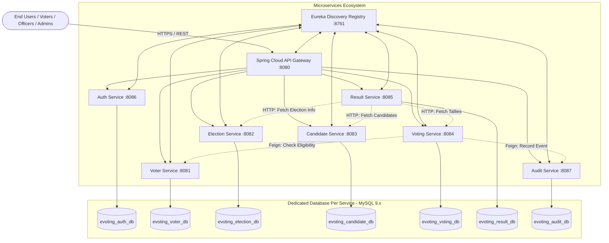
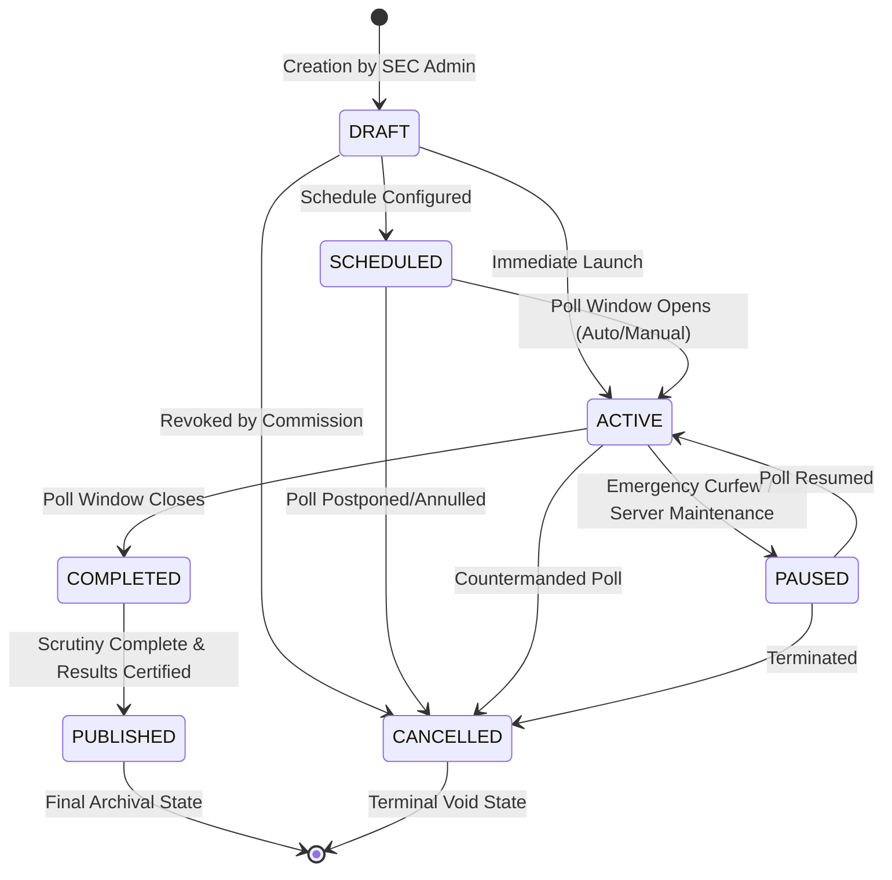
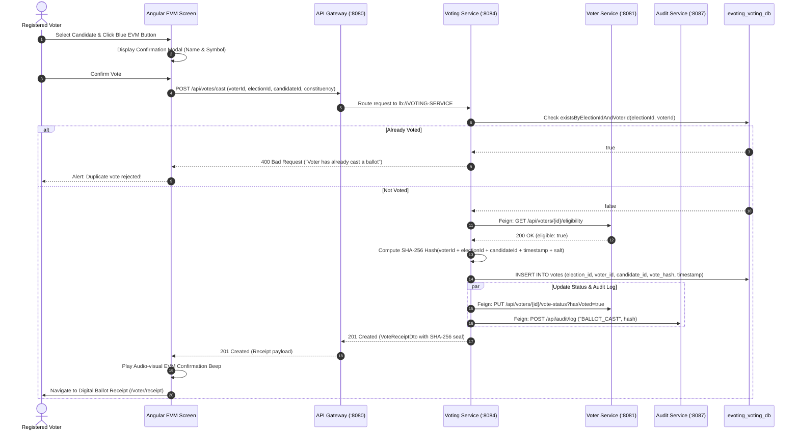

# SOFTWARE REQUIREMENTS SPECIFICATION (SRS)
## E-Voting Pilot System for Local Body Elections
**Pilot Implementation: Bihar State Electoral Simulation & Delimitation 2026**

---

### Document Control Information

| Attribute | Details |
| :--- | :--- |
| **Document Title** | Software Requirements Specification (SRS) for E-Voting Pilot System |
| **Document Version** | 1.0.0 (Release Baseline) |
| **Project Code** | EVOTE-SEC-2026 |
| **Standard Compliance** | IEEE Std 830-1998 / ISO/IEC/IEEE 29148:2018 |
| **Jurisdiction / Focus** | Bihar State Election Commission (SEC) & ECI Pilot Simulation (Sitamarhi Pilot) |
| **Status** | Approved & Production-Ready Specification |
| **Date of Specification** | October 2026 |
| **Classification** | Official Electoral Technology Specification |

---

## Table of Contents

1. [Introduction](#1-introduction)
   - 1.1 Purpose
   - 1.2 Document Conventions
   - 1.3 Intended Audience and Reading Suggestions
   - 1.4 Product Scope and Objectives
   - 1.5 Definitions, Acronyms, and Abbreviations
   - 1.6 References
2. [Overall Description](#2-overall-description)
   - 2.1 Product Perspective & System Context
   - 2.2 Product Functions Overview
   - 2.3 User Classes and Personas
   - 2.4 Operating Environment
   - 2.5 Design and Implementation Constraints
   - 2.6 User Documentation
   - 2.7 Assumptions and Dependencies
3. [System Architecture & Data Specifications](#3-system-architecture--data-specifications)
   - 3.1 Microservices Topology & Inter-Service Feign Communication
   - 3.2 Database-per-Service Architecture & Schemas
   - 3.3 State Machine: Election Lifecycle Transitions
   - 3.4 Cryptographic Ballot Casting & Hash Verification Flow
4. [External Interface Requirements](#4-external-interface-requirements)
   - 4.1 User Interfaces (Angular 22 EVM Layout & Role Portals)
   - 4.2 Hardware Interfaces
   - 4.3 Software Interfaces & API Gateway Routing
   - 4.4 Communications Interfaces & Security Protocols
5. [System Features & Functional Requirements (FRs)](#5-system-features--functional-requirements-frs)
   - 5.1 Module 1: Identity & Access Management (IAM)
   - 5.2 Module 2: Voter Registration & Roll Eligibility
   - 5.3 Module 3: Election Lifecycle & Administrative Delimitation
   - 5.4 Module 4: Candidate Nomination & Party Management
   - 5.5 Module 5: Secure EVM Ballot Casting & SHA-256 Receipt Seal
   - 5.6 Module 6: Result Tabulation & Winner Calculation
   - 5.7 Module 7: Immutable Audit Trail & Regulatory Compliance
   - 5.8 Module 8: System Infrastructure & Telemetry Monitoring
6. [Non-Functional Requirements (NFRs)](#6-non-functional-requirements-nfrs)
   - 6.1 Performance & Scalability
   - 6.2 Security & Cryptographic Integrity
   - 6.3 Reliability & Fault Tolerance
   - 6.4 Maintainability & Portability
   - 6.5 Usability, Inclusivity & Accessibility
   - 6.6 Statutory & Legal Compliance
7. [Traceability Matrix & Verification Criteria](#7-traceability-matrix--verification-criteria)
   - 7.1 Requirements Traceability Matrix (RTM)
   - 7.2 Acceptance Criteria & Verification Methods
8. [Appendices](#8-appendices)
   - Appendix A: Bihar Administrative Hierarchy & Delimitation Master
   - Appendix B: API Error Codes & Exception Mapping

---

## 1. Introduction

### 1.1 Purpose
The purpose of this Software Requirements Specification (SRS) is to establish a rigorous, comprehensive, and legally auditable definition of the functional and non-functional requirements for the **E-Voting Pilot System for Local Body Elections**. This document specifies the exact software behaviors, architectural contracts, cryptographic safeguards, data schemas, and user interfaces governing both municipal and panchayati raj electoral pilot simulations in the State of Bihar, India.

### 1.2 Document Conventions
This specification adheres to IEEE Std 830-1998 recommendations:
- The keywords **MUST**, **MUST NOT**, **REQUIRED**, **SHALL**, **SHALL NOT**, **SHOULD**, **RECOMMENDED**, and **MAY** in this document are interpreted as described in RFC 2119.
- Functional Requirement identifiers follow the standardized scheme: `FR-[MODULE]-[NUMBER]`.
- Non-Functional Requirement identifiers follow: `NFR-[CATEGORY]-[NUMBER]`.

### 1.3 Intended Audience and Reading Suggestions
- **Election Commission Officials (SEC / ECI)**: Focus on Section 1.4 (Scope), Section 2.2 (Functions), Section 5.3 (Election Lifecycle), Section 5.5 (Voting), and Section 6.6 (Compliance).
- **Solution Architects & Tech Leads**: Review Section 3 (System Architecture & Schemas), Section 4 (Interfaces), and Section 6 (NFRs).
- **Backend & Frontend Software Engineers**: Implement strictly according to Section 5 (Functional Requirements), Section 4.3 (Gateway Routes), and Section 7.1 (Traceability Matrix).
- **Quality Assurance & Security Auditors**: Execute verification against Section 6.2 (Security), Section 7 (Acceptance & RTM), and Appendix B (Exceptions).

### 1.4 Product Scope and Objectives
The **E-Voting Pilot System** is a next-generation electronic voting and election administration platform engineered to digitize, secure, and streamline local self-government elections. It incorporates the complete administrative and electoral hierarchy of the State of Bihar (9 Administrative Divisions, 38 Districts, 40 Parliamentary Constituencies, 243 Assembly Constituencies, and the 2026 Delimitation Framework for Panchayats and Urban Local Bodies).

#### Core Objectives:
1. **Prevent Voter Disenfranchisement**: Enable authenticated remote and kiosk-based local voting with real-time Electoral Photo Identity Card (EPIC) validation and OTP dual-factor authorization.
2. **Eliminate Duplicate Voting**: Enforce absolute single-ballot guarantees through application-level state checks and database-level composite unique constraints across distributed services.
3. **Preserve Ballot Secrecy While Ensuring Verifiability**: Decouple the voter's identity from the recorded candidate tally while providing the voter with an immutable SHA-256 cryptographic receipt seal.
4. **Support Multi-Tier Delimitation**: Facilitate concurrent elections across different administrative tiers: Gram Panchayat Mukhiya, Ward Member, Panchayat Samiti, Zila Parishad, Nagar Nigam / Municipal Corporation Mayor/Councillor, Vidhan Sabha (MLA), and Lok Sabha (MP).
5. **Real-Time Auditing & Tallying**: Deliver transparent turnout telemetry and instantaneous result tabulation with zero risk of manual booth-capturing or physical ballot tampering.

### 1.5 Definitions, Acronyms, and Abbreviations

| Term / Acronym | Definition |
| :--- | :--- |
| **AC** | Assembly Constituency (Vidhan Sabha constituency) |
| **API** | Application Programming Interface |
| **BCrypt** | Adaptive password hashing function based on the Blowfish cipher |
| **CORS** | Cross-Origin Resource Sharing |
| **EPIC** | Electoral Photo Identity Card (Voter ID issued by ECI) |
| **EVM** | Electronic Voting Machine (simulated digital ballot unit interface) |
| **ECI** | Election Commission of India |
| **GP** | Gram Panchayat (grassroots village governing institution) |
| **JWT** | JSON Web Token (RFC 7519) |
| **MP** | Member of Parliament (Lok Sabha representative) |
| **MLA** | Member of Legislative Assembly (Vidhan Sabha representative) |
| **NFR** | Non-Functional Requirement |
| **NOTA** | None of the Above (statutory ballot option) |
| **OTP** | One-Time Password |
| **PC** | Parliamentary Constituency (Lok Sabha constituency) |
| **RBAC** | Role-Based Access Control |
| **RTM** | Requirements Traceability Matrix |
| **SEC** | State Election Commission, Bihar |
| **SHA-256** | Secure Hash Algorithm generating a 256-bit cryptographic digest |
| **SRS** | Software Requirements Specification |
| **SSR** | Server-Side Rendering (Angular SSR Engine) |
| **STV** | Single Transferable Vote (used for Rajya Sabha elections) |
| **ULB** | Urban Local Body (Nagar Nigam, Nagar Parishad, Nagar Panchayat) |

### 1.6 References
1. IEEE Std 830-1998: *Recommended Practice for Software Requirements Specifications*.
2. ISO/IEC/IEEE 29148:2018: *Systems and software engineering — Life cycle processes — Requirements engineering*.
3. Constitution of India: *Articles 243K and 243ZA (Elections to Panchayats and Municipalities)*.
4. The Representation of the People Act, 1950 & 1951 (Government of India).
5. Bihar Panchayat Raj Act, 2006 (Amended 2021 & 2026 Delimitation Directives).
6. National Institute of Standards and Technology (NIST) SP 800-52: *Guidelines for TLS Implementations*.
7. Spring Cloud Gateway & Netflix Eureka Technical Documentation (Spring 2024.0.0 / Boot 3.4.2).

---

## 2. Overall Description

### 2.1 Product Perspective & System Context
The E-Voting Pilot System is a self-contained, cloud-ready, distributed multi-tier system built using modern enterprise patterns. The system decouples concerns across 9 independent microservices in the backend and a reactive Angular 22 frontend:



### 2.2 Product Functions Overview
1. **Identity & Access Management**: Secure registration, EPIC lookup, OTP delivery and verification, JWT token issuance with role payloads, and session lifecycle control.
2. **Electoral Roll & Delimitation Directory**: Registration of eligible citizens, EPIC uniqueness verification, demographic constituency binding down to Gram Panchayat / Municipal Ward.
3. **Multi-Tier Election Administration**: End-to-end election lifecycle state machine (DRAFT, SCHEDULED, ACTIVE, PAUSED, COMPLETED, PUBLISHED, CANCELLED), nomination window setup, schedule automation.
4. **Candidate Affiliation & Manifesto Management**: Candidate nomination filings, official party affiliation, election symbol allocation, public bio and policy manifesto publication.
5. **Simulated EVM Ballot Unit & Cryptographic Voting**: High-fidelity digital replica of EVM ballot unit (Candidate name, party symbol, tactile voting button, audible/visual feedback), double-voting prevention, and cryptographic SHA-256 digital receipt issuance.
6. **Real-Time Result Tabulation & Winner Calculation**: Automated tallies aggregation, percentage turnout computing, vote count breakdown per booth/ward, and automatic winner declaration.
7. **Comprehensive Audit & Surveillance**: Centralized immutable audit logs capturing actor, IP, timestamp, entity affected, and tamper-resistant transaction footprints.
8. **DevOps & Cluster Monitoring**: Live telemetry of microservices health, Eureka registry statuses, database connections, and API Gateway route health.

### 2.3 User Classes and Personas

| Role Name | Description & Responsibilities | Access Level / Permissions |
| :--- | :--- | :--- |
| **Public / Citizen** | Unauthenticated visitors browsing elections, candidate lists, and election results. | Public read-only (`/`, `/results`, `/voter-info`, `/candidate-info`) |
| **Voter (`ROLE_VOTER`)** | Enrolled citizen holding valid EPIC number. Casts one secret ballot per active election. | Authenticated Voter Portal (`/voter/**`) |
| **Candidate (`ROLE_CANDIDATE`)** | Verified candidate contesting an election. Views profile status, manifesto, and ward results. | Candidate Portal (`/candidate/**`) |
| **Party Representative (`ROLE_PARTY`)** | Authorized delegate of a political party. Submits candidates and uploads party manifestos. | Party Portal (`/party/**`) |
| **Election Officer (`ROLE_OFFICER`)** | Presiding officer at polling station. Verifies in-person identity, monitors queues, logs turnouts. | Polling Officer Portal (`/officer/**`) |
| **Observer / Auditor (`ROLE_AUDITOR`)** | Statutory observer or independent auditor. Audits voting tallies, turnout anomalies, and log trails. | Auditor Portal (`/auditor/**`, `/observer/**`) |
| **Administrator (`ROLE_ADMIN`)** | State Election Commission official. Manages elections, delimitation, candidates, and voters. | Admin Portal (`/admin/**`) |
| **Super Administrator (`ROLE_SUPER_ADMIN`)** | Chief Electoral Authority. Controls system roles, overrides critical statuses, system wide settings. | Super Admin Portal (`/super-admin/**`) |
| **System Administrator** | Infrastructure engineer. Monitors Eureka discovery, Spring Boot microservices health, and logs. | System Infrastructure Portal (`/system/**`) |

### 2.4 Operating Environment
- **Client Devices**: Modern web browsers (Google Chrome 110+, Mozilla Firefox 115+, Microsoft Edge 110+, Safari 16+) with JavaScript enabled; fully responsive across Mobile (360px+), Tablet (768px+), and Desktop (1024px+).
- **Frontend Runtime**: Angular 22.x running Node.js 22+ / 24+ with optional Angular SSR.
- **Backend Runtime**: Java Virtual Machine (OpenJDK 21 LTS), Spring Boot 3.4.2, Spring Cloud 2024.0.0.
- **Service Discovery**: Netflix Eureka Server running on port 8761.
- **API Gateway**: Spring Cloud Gateway running on port 8080.
- **Persistence Store**: MySQL Database Server version 8.4 LTS or 9.x running on port 3306 with UTF-8 (`utf8mb4_unicode_ci`).
- **Operating Systems**: Windows Server / Windows 11, Linux (Ubuntu 22.04 LTS / RHEL 9), or Docker Container Engines.

### 2.5 Design and Implementation Constraints
1. **Zero External Dependency on Mocks in Production**: Production deployments must execute exclusively through live backend microservices. Fallback mocks exist solely in development profiles.
2. **Ballot Anonymity & Secret Suffrage**: The system SHALL NEVER store a direct association between the voter's identity and the candidate selected in any publicly readable or auditable reporting table.
3. **Database-per-Service Separation**: Each microservice maintains its own relational database schema. Cross-database foreign keys are strictly prohibited; inter-service data integrity is enforced via REST/OpenFeign communication.
4. **Statutory Delimitation Rules**: The system must adhere to Bihar Panchayati Raj reservation norms (General, Backward Class, Extremely Backward Class, Scheduled Caste, Female reservations).

### 2.6 User Documentation
The system shall provide comprehensive user manuals, including:
- Interactive in-app Help Center (`/help`).
- Presiding Officer Standard Operating Procedure (SOP) Guide for booth voter check-ins.
- System Administration and Disaster Recovery Manual.
- Swagger / OpenAPI specifications for all 7 REST microservices.

### 2.7 Assumptions and Dependencies
- Network connectivity of at least 256 kbps is available at polling centers / user client devices.
- Voter identity data aligns with official Election Commission of India (ECI) database formats.
- System clocks on all microservice host servers are synchronized via Network Time Protocol (NTP).

---

## 3. System Architecture & Data Specifications

### 3.1 Microservices Topology & Inter-Service Feign Communication
Communication between services is strictly governed by service discovery via Netflix Eureka:

```
[API Gateway :8080]
  ├──> lb://AUTH-SERVICE      (:8086) ──> evoting_auth_db
  ├──> lb://VOTER-SERVICE     (:8081) ──> evoting_voter_db
  ├──> lb://ELECTION-SERVICE  (:8082) ──> evoting_election_db
  ├──> lb://CANDIDATE-SERVICE (:8083) ──> evoting_candidate_db
  ├──> lb://VOTING-SERVICE    (:8084) ──> evoting_voting_db
  │      ├── OpenFeign ──> VOTER-SERVICE (:8081) [Check Eligibility & Mark Voted]
  │      └── OpenFeign ──> AUDIT-SERVICE (:8087) [Log Ballot Cast Event]
  ├──> lb://RESULT-SERVICE    (:8085) ──> evoting_result_db
  │      ├── RestTemplate ──> VOTING-SERVICE (:8084)    [Fetch Tallies]
  │      ├── RestTemplate ──> CANDIDATE-SERVICE (:8083) [Fetch Candidates]
  │      └── RestTemplate ──> ELECTION-SERVICE (:8082)  [Fetch Election Details]
  └──> lb://AUDIT-SERVICE     (:8087) ──> evoting_audit_db
```

### 3.2 Database-per-Service Architecture & Schemas

#### 1. Auth Service Database (`evoting_auth_db`)
- `users`: `id (PK, BIGINT)`, `username (VARCHAR(50), UNIQUE)`, `email (VARCHAR(100), UNIQUE)`, `password_hash (VARCHAR(255))`, `enabled (BOOLEAN)`, `created_at (TIMESTAMP)`.
- `roles`: `id (PK, BIGINT)`, `name (VARCHAR(50), UNIQUE)`. Valid roles: `ROLE_ADMIN`, `ROLE_SUPER_ADMIN`, `ROLE_CANDIDATE`, `ROLE_PARTY`, `ROLE_VOTER`, `ROLE_AUDITOR`.
- `user_roles`: `user_id (FK)`, `role_id (FK)` (Composite Primary Key).

#### 2. Voter Service Database (`evoting_voter_db`)
- `voter_profiles`:
  - `id`: BIGINT AUTO_INCREMENT PRIMARY KEY
  - `user_id`: BIGINT (maps to auth user)
  - `epic_number`: VARCHAR(50) NOT NULL UNIQUE (Electoral Card Number)
  - `full_name`: VARCHAR(100) NOT NULL
  - `email`: VARCHAR(100) NOT NULL UNIQUE
  - `phone`: VARCHAR(20) NOT NULL
  - `constituency`: VARCHAR(100) NOT NULL
  - `is_verified`: BOOLEAN NOT NULL DEFAULT FALSE
  - `has_voted`: BOOLEAN NOT NULL DEFAULT FALSE
  - `registered_at`: TIMESTAMP DEFAULT CURRENT_TIMESTAMP

#### 3. Election Service Database (`evoting_election_db`)
- `states`: `id (PK)`, `name (VARCHAR(100))`, `code (VARCHAR(10))`.
- `administrative_divisions`: `id (PK)`, `name (VARCHAR(100))`, `headquarters (VARCHAR(100))`, `districts_count (INT)`.
- `districts`: `id (PK)`, `state_id (FK)`, `division_id (FK)`, `name (VARCHAR(100))`, `headquarters (VARCHAR(100))`.
- `sub_divisions`: `id (PK)`, `district_id (FK)`, `name (VARCHAR(100))`.
- `blocks`: `id (PK)`, `sub_division_id (FK)`, `name (VARCHAR(100))`.
- `parliamentary_constituencies`: `id (PK)`, `pc_number (INT UNIQUE)`, `name`, `category (GEN/SC/ST)`.
- `assembly_constituencies`: `id (PK)`, `ac_number (INT UNIQUE)`, `name`, `category`, `parliamentary_id (FK)`.
- `gram_panchayats`: `id (PK)`, `block_id (FK)`, `name`, `panchayat_code`.
- `wards`: `id (PK)`, `gram_panchayat_id (FK, nullable)`, `municipal_body_name`, `ward_number`, `delimitation_year`, `reservation_status`.
- `elections`:
  - `id`: BIGINT AUTO_INCREMENT PRIMARY KEY
  - `title`: VARCHAR(150) NOT NULL
  - `description`: VARCHAR(1000)
  - `start_date`: DATETIME NOT NULL
  - `end_date`: DATETIME NOT NULL
  - `status`: VARCHAR(30) NOT NULL (`DRAFT`, `SCHEDULED`, `ACTIVE`, `PAUSED`, `COMPLETED`, `PUBLISHED`, `CANCELLED`)
  - `election_type`: VARCHAR(50) NOT NULL (`LOK_SABHA`, `VIDHAN_SABHA`, `PANCHAYAT_MUKHIYA`, `PANCHAYAT_WARD`, `ZILA_PARISHAD`, `PANCHAYAT_SAMITI`, `MUNICIPAL_MAYOR`)
  - `constituency`: VARCHAR(150)
  - `ward`: VARCHAR(50)
  - `created_at`: TIMESTAMP DEFAULT CURRENT_TIMESTAMP

#### 4. Candidate Service Database (`evoting_candidate_db`)
- `candidates`:
  - `id`: BIGINT AUTO_INCREMENT PRIMARY KEY
  - `election_id`: BIGINT NOT NULL
  - `full_name`: VARCHAR(100) NOT NULL
  - `party_name`: VARCHAR(100) NOT NULL
  - `symbol_url`: VARCHAR(255)
  - `constituency`: VARCHAR(100) NOT NULL
  - `bio`: VARCHAR(1000)
  - `manifesto`: TEXT
  - `nomination_status`: VARCHAR(30) DEFAULT 'APPROVED' (`PENDING`, `APPROVED`, `REJECTED`)
  - `created_at`: TIMESTAMP DEFAULT CURRENT_TIMESTAMP

#### 5. Voting Service Database (`evoting_voting_db`)
- `votes`:
  - `id`: BIGINT AUTO_INCREMENT PRIMARY KEY
  - `election_id`: BIGINT NOT NULL
  - `voter_id`: BIGINT NOT NULL
  - `candidate_id`: BIGINT NOT NULL
  - `constituency`: VARCHAR(100) NOT NULL
  - `timestamp`: DATETIME NOT NULL DEFAULT CURRENT_TIMESTAMP
  - `vote_hash`: VARCHAR(64) NOT NULL (SHA-256 seal)
  - **Constraints**: `UNIQUE KEY uk_election_voter (electionId, voterId)` (Guarantees absolute one-voter-one-vote rule at the storage engine level).

#### 6. Result Service Database (`evoting_result_db`)
- Computes in-memory aggregations via REST endpoints and caches results:
  - Total election turnouts, candidate percentages, margin of victory, leading/elected candidate determination.

#### 7. Audit Service Database (`evoting_audit_db`)
- `audit_logs`:
  - `id`: BIGINT AUTO_INCREMENT PRIMARY KEY
  - `action`: VARCHAR(100) NOT NULL (e.g., `BALLOT_CAST`, `STATUS_TRANSITION`, `CANDIDATE_FILED`)
  - `actor_id`: BIGINT
  - `actor_username`: VARCHAR(50)
  - `actor_role`: VARCHAR(50)
  - `entity_type`: VARCHAR(50) NOT NULL (e.g., `VOTE`, `ELECTION`, `VOTER`)
  - `entity_id`: VARCHAR(50)
  - `ip_address`: VARCHAR(45)
  - `details`: TEXT
  - `timestamp`: TIMESTAMP NOT NULL DEFAULT CURRENT_TIMESTAMP

---

### 3.3 State Machine: Election Lifecycle Transitions
The `ElectionStatus` enum in `election-service` enforces strict deterministic transitions to prevent voting outside legal poll windows:



### 3.4 Cryptographic Ballot Casting & Hash Verification Flow



---

## 4. External Interface Requirements

### 4.1 User Interfaces (Angular 22 EVM Layout & Role Portals)
- **EVM Voting Terminal Interface (`/voter/vote/:electionId`)**:
  - High-contrast, tactile-styled digital replica of Indian Electronic Voting Machine (Ballot Unit).
  - Serial Number, Candidate Name, Political Party, SVG Symbol badge, and Action/LED Indicator.
  - Visual feedback: Blue button depression, red LED activation upon casting, and confirmation dialogue.
- **Vote Confirmation Screen (`/voter/vote-confirmation`)**:
  - Modal dialogue summarizing election title, candidate chosen, and symbol prior to final non-reversible dispatch.
- **Cryptographic Receipt View (`/voter/receipt`)**:
  - Displays generated SHA-256 transaction hash, timestamp, election title, and verified stamp. Provides one-click PDF/Print download option.
- **Interactive Dashboards**:
  - **Voter Dashboard**: Displays current registration status, active elections in voter's constituency, voting history, and candidate dossiers.
  - **Presiding Officer Dashboard**: Real-time booth turnout graph, queue management, manual voter verification lookup.
  - **State Election Commission (Admin) Dashboard**: Comprehensive election orchestrator, candidate scrutiny workbench, turnout heatmaps.

### 4.2 Hardware Interfaces
- The web application operates on standard computing hardware (smartphones, tablets, touchscreens, standard desktop monitors).
- EVM Kiosk terminals: Compatible with standard touch interfaces and dedicated physical external keypad switches.
- Thermal Printer Interface: Generates printable receipt layouts formatted for standard 80mm thermal receipt printers.

### 4.3 Software Interfaces & API Gateway Routing
The Spring Cloud Gateway routes client traffic as defined below:

| Inbound Path Route | Target Microservice URI | Primary Functions |
| :--- | :--- | :--- |
| `/api/auth/**` | `lb://AUTH-SERVICE` (:8086) | Login, Register, OTP Send/Verify, Token Refresh |
| `/api/voters/**` | `lb://VOTER-SERVICE` (:8081) | EPIC lookup, Roll check, Eligibility, Status update |
| `/api/elections/**` | `lb://ELECTION-SERVICE` (:8082) | Election CRUD, Status transition, Constituency list |
| `/api/candidates/**` | `lb://CANDIDATE-SERVICE` (:8083) | Candidate CRUD, Affidavits, Manifestos |
| `/api/votes/**` | `lb://VOTING-SERVICE` (:8084) | Ballot casting, Double-vote check, Tally queries |
| `/api/results/**` | `lb://RESULT-SERVICE` (:8085) | Real-time result aggregation, Leading candidate, Winner |
| `/api/audit/**` | `lb://AUDIT-SERVICE` (:8087) | Regulatory log queries, Event persistence |

### 4.4 Communications Interfaces & Security Protocols
- **Transport Security**: All HTTP requests in production MUST be transmitted over TLS 1.3 / HTTPS.
- **CORS Architecture**: API Gateway configures white-listed origins (`http://localhost:4200`, `http://127.0.0.1:4200`), allowing `GET, POST, PUT, DELETE, PATCH, OPTIONS` with `allowCredentials: true`.
- **Authentication Headers**: `Authorization: Bearer <JWT_TOKEN>` attached to all protected API calls via Angular HTTP Interceptor (`authInterceptor`).

---

## 5. System Features & Functional Requirements (FRs)

### 5.1 Module 1: Identity & Access Management (IAM)

#### FR-AUTH-01: User Registration
- **Description**: The system shall register new users with email, username, and BCrypt-hashed password.
- **Input**: `RegisterRequest` (username, email, password, roles).
- **Processing**: Validate email and username uniqueness. Encrypt password using BCrypt with salt factor 10. Persist user and assign specified roles.
- **Output**: `AuthResponse` containing generated JWT token, username, email, and assigned roles.

#### FR-AUTH-02: Voter OTP Verification & Dual-Factor Login
- **Description**: The system shall enable voters to request an OTP and authenticate using their EPIC or registered mobile/email.
- **Input**: `OtpSendRequest` (identifier), `OtpVerifyLoginRequest` (identifier, otpCode).
- **Processing**: Validate 6-digit OTP against active cache/store. On success, issue JWT token with `ROLE_VOTER` claim.
- **Output**: Authenticated JWT token and user profile.

#### FR-AUTH-03: Role-Based Authorization
- **Description**: The system shall enforce role constraints on all routes and REST endpoints.
- **Processing**: Validate JWT signature and permissions before executing controllers. Reject unauthorized roles with HTTP 403 Forbidden.

#### FR-AUTH-04: Token Refresh Mechanism
- **Description**: The system shall issue refreshed JWT tokens prior to token expiration without requiring full re-login.

---

### 5.2 Module 2: Voter Registration & Roll Eligibility

#### FR-VOTER-01: EPIC Number Voter Roll Lookup
- **Description**: The system shall retrieve voter demographic and constituency details by unique EPIC number.
- **Endpoint**: `GET /api/voters/epic/{epicNumber}`.
- **Output**: Full name, constituency, verification status, and voting eligibility.

#### FR-VOTER-02: Voter Registration & Profile Creation
- **Description**: The system shall register a citizen into the electoral roll.
- **Input**: `VoterRegistrationDto` (epicNumber, fullName, email, phone, constituency).
- **Processing**: Validate format of EPIC number (alphanumeric 10 characters). Check uniqueness. Create record in `voter_profiles`.

#### FR-VOTER-03: Real-Time Eligibility Verification
- **Description**: The system shall provide an eligibility check for active voting.
- **Endpoint**: `GET /api/voters/{id}/eligibility`.
- **Processing**: Check if voter is verified (`is_verified == true`) and has not yet voted (`has_voted == false`).
- **Output**: `VoterEligibilityDto` (`eligible: boolean, reason: string`).

#### FR-VOTER-04: Voting Status Synchronization
- **Description**: Atomically mark the voter as having voted upon successful ballot casting.
- **Endpoint**: `PUT /api/voters/{id}/vote-status?hasVoted=true`.

---

### 5.3 Module 3: Election Lifecycle & Administrative Delimitation

#### FR-ELEC-01: Multi-Tier Election Creation
- **Description**: Authorized SEC Admins shall configure new elections under local body or legislative tiers.
- **Input**: `ElectionDto` (title, description, startDate, endDate, electionType, constituency, ward).
- **Processing**: Validate dates (`startDate < endDate`). Persist election with initial status `DRAFT`.

#### FR-ELEC-02: Election Lifecycle Transition Engine
- **Description**: Transition election states adhering strictly to Section 3.3 state machine rules.
- **Endpoint**: `PUT /api/elections/{id}/status?status={status}`.
- **Constraint**: Invalid transitions (e.g., `PUBLISHED -> DRAFT` or `COMPLETED -> ACTIVE`) shall be rejected with HTTP 400 and logged as security violations.

#### FR-ELEC-03: Delimitation Hierarchy Retrieval
- **Description**: The system shall provide master administrative hierarchy data for Bihar (Divisions, Districts, Sub-Divisions, Blocks, PCs, ACs, Gram Panchayats, Wards).
- **Target Pilot**: Complete data for Sitamarhi District (Sadar, Pupri, Belsand sub-divisions; 17 Blocks; 8 Assembly Constituencies).

---

### 5.4 Module 4: Candidate Nomination & Party Management

#### FR-CAND-01: Candidate Nomination Filing
- **Description**: Candidates or authorized political party delegates shall submit nomination affidavits.
- **Input**: `CandidateDto` (electionId, fullName, partyName, symbolUrl, constituency, bio, manifesto).
- **Processing**: Validate election existence and nomination deadline. Set nomination status to `PENDING` or `APPROVED`.

#### FR-CAND-02: Candidate Electoral Roll by Constituency
- **Description**: Retrieve active, approved candidates filtered by election ID and specific ward/constituency.
- **Endpoint**: `GET /api/candidates/election/{electionId}/constituency/{constituency}`.

#### FR-CAND-03: Manifesto & Policy Document Management
- **Description**: Allow candidates and parties to publish manifestos and civic development roadmaps accessible to voters.

---

### 5.5 Module 5: Secure EVM Ballot Casting & SHA-256 Receipt Seal

#### FR-VOTE-01: Interactive EVM Ballot Presentation
- **Description**: Present voter with ballot unit containing all registered candidates for their registered constituency in random or alphabetical order, including NOTA (None of the Above).

#### FR-VOTE-02: Double-Voting Prevention (Two-Layer Guard)
- **Description**: Guarantee that no voter can cast more than one ballot in any single election.
- **Processing**:
  - *Layer 1 (Application)*: Query `voteRepository.existsByElectionIdAndVoterId(electionId, voterId)`. Throw `IllegalStateException` if true.
  - *Layer 2 (Database Engine)*: Table constraint `uk_election_voter (electionId, voterId)` guarantees immediate transaction rollback if concurrent threads collide.

#### FR-VOTE-03: Inter-Service Eligibility Verification
- **Description**: The Voting Service shall make a synchronous Feign call to Voter Service to verify voter eligibility prior to ballot recording.

#### FR-VOTE-04: Cryptographic Receipt Seal Generation
- **Description**: Compute a cryptographically strong SHA-256 digital seal for the vote.
- **Algorithm**: `SHA-256(voterId + ":" + electionId + ":" + candidateId + ":" + timestamp + ":" + UUID.randomUUID())`.
- **Output**: 64-character hexadecimal digest returned in `VoteReceiptDto`.

#### FR-VOTE-05: Atomic Inter-Service Transaction & Audit Dispatch
- **Description**: Upon persisting the vote, invoke Voter Service to set `hasVoted = true` and dispatch `BALLOT_CAST` event to Audit Service under transaction control.

---

### 5.6 Module 6: Result Tabulation & Winner Calculation

#### FR-RES-01: Real-Time Vote Aggregation
- **Description**: The Result Service shall aggregate live vote counts per candidate from the Voting Service without caching stale data.
- **Endpoint**: `GET /api/results/election/{electionId}`.

#### FR-RES-02: Turnout & Percentage Share Computation
- **Description**: Calculate vote percentage share per candidate rounded to 2 decimal places: `percentage = (votes / totalVotes) * 100.0`.

#### FR-RES-03: Dynamic Winner & Leading Candidate Determination
- **Description**: Sort candidate tallies descending. Identify candidate with highest vote count as `leadingOrWinner`. Return null if total votes cast is zero.

#### FR-RES-04: Public Result Declaration
- **Description**: Restrict public publication of final certified results until the election status is marked `COMPLETED` or `PUBLISHED` by SEC administrators.

---

### 5.7 Module 7: Immutable Audit Trail & Regulatory Compliance

#### FR-AUD-01: System-Wide Audit Event Logging
- **Description**: The Audit Service shall record immutable audit entries for all security-sensitive actions (`BALLOT_CAST`, `STATUS_CHANGE`, `USER_LOGIN`, `REGISTRATION`).
- **Endpoint**: `POST /api/audit/log`.
- **Data Captured**: `action, actorId, actorUsername, actorRole, entityType, entityId, ipAddress, details, timestamp`.

#### FR-AUD-02: Chronological Audit Trail Inspection
- **Description**: Provide paginated and filtered audit trail views for electoral observers and judicial audits.
- **Endpoints**:
  - `GET /api/audit/logs?page=0&size=20`
  - `GET /api/audit/entity/{entityType}`
  - `GET /api/audit/action/{action}`

---

### 5.8 Module 8: System Infrastructure & Telemetry Monitoring

#### FR-SYS-01: Service Registration & Discovery Monitoring
- **Description**: Netflix Eureka Dashboard at port 8761 shall monitor heartbeat and liveness of all 7 microservices and the API Gateway.

#### FR-SYS-02: Spring Cloud Gateway Route Telemetry
- **Description**: Gateway actuator endpoints (`/actuator/health`, `/actuator/gateway/routes`) shall expose real-time routing status.

#### FR-SYS-03: Database Connection Pool Surveillance
- **Description**: Monitor active, idle, and max connections across all 7 MySQL schemas to prevent connection exhaustion during peak polling hours.

---

## 6. Non-Functional Requirements (NFRs)

### 6.1 Performance & Scalability
- **NFR-PERF-01**: **Ballot Submission Latency**: The 95th percentile response time for `POST /api/votes/cast` SHALL NOT exceed **250 milliseconds** under a normal concurrent load of 5,000 requests per minute.
- **NFR-PERF-02**: **Throughput Capacity**: The API Gateway and Voting Service SHALL sustain at least **1,000 transactions per second (TPS)** per node instance.
- **NFR-PERF-03**: **Result Aggregation**: Result calculation for an election with 500,000 votes across 50 candidates SHALL complete within **1.5 seconds**.

### 6.2 Security & Cryptographic Integrity
- **NFR-SEC-01**: **Password Protection**: Passwords SHALL be hashed using BCrypt with an iteration work factor of at least 10. Passwords in plaintext SHALL NEVER be logged or persisted.
- **NFR-SEC-02**: **Cryptographic Hash Tamper Evidence**: Vote records SHALL store a SHA-256 hash digest. Any manual modification of database rows will invalidate the hash verification check.
- **NFR-SEC-03**: **Ballot Secrecy Protection**: The system architecture SHALL prohibit any query or report that links a voter's identity directly with their political choice in public result endpoints.
- **NFR-SEC-04**: **Token Security**: JWT tokens SHALL use HMAC-SHA256 with a 256-bit secret key, with an access token lifespan not exceeding 60 minutes.
- **NFR-SEC-05**: **OWASP Top 10 Mitigation**:
  - SQL Injection: Mitigated by mandatory Spring Data JPA parameterized prepared statements.
  - Cross-Site Scripting (XSS): Mitigated by Angular automatic context-aware HTML sanitization.
  - Cross-Site Request Forgery (CSRF): Mitigated by stateless JWT bearer authentication.

### 6.3 Reliability & Fault Tolerance
- **NFR-REL-01**: **High Availability**: The core voting and gateway infrastructure SHALL achieve **99.99% availability** during active polling windows.
- **NFR-REL-02**: **Database ACID Transactions**: Ballot casting, voter status update, and receipt generation SHALL execute under strict Spring `@Transactional` ACID boundaries.
- **NFR-REL-03**: **Graceful Service Degradation**: If the Audit Service is temporarily unreachable, the Voting Service SHALL record the vote locally and queue audit events without rejecting the voter's valid ballot.

### 6.4 Maintainability & Portability
- **NFR-MAIN-01**: **Containerization**: All microservices and frontend applications SHALL be deployable as standard Open Container Initiative (OCI) Docker containers.
- **NFR-MAIN-02**: **Decoupled Architecture**: Microservices SHALL NOT share internal database tables or have tight binary coupling outside public REST API contracts.

### 6.5 Usability, Inclusivity & Accessibility
- **NFR-A11Y-01**: **WCAG 2.1 Compliance**: The user interface SHALL conform to WCAG 2.1 Level AA standards.
- **NFR-A11Y-02**: **Bilingual Support**: All public and voter-facing interfaces SHALL support English and Hindi labels and instructions.
- **NFR-A11Y-03**: **High-Contrast EVM Design**: The EVM ballot unit SHALL support high-contrast visual cues, distinguishable candidate party symbols, and large tactile button targets.

### 6.6 Statutory & Legal Compliance
- **NFR-COMP-01**: The system design complies with the fundamental requirements of free, fair, and transparent voting stipulated under Articles 243K and 243ZA of the Constitution of India.
- **NFR-COMP-02**: The system provides verifiable audit trails admissible under Section 65B of the Indian Evidence Act for electronic records.

---

## 7. Traceability Matrix & Verification Criteria

### 7.1 Requirements Traceability Matrix (RTM)

| Requirement ID | Functional Scope | Microservice Backend | Controller Endpoint | Frontend Route / Component |
| :--- | :--- | :--- | :--- | :--- |
| **FR-AUTH-01** | User Registration | `auth-service` (:8086) | `POST /api/auth/register` | `/register` (`RegisterComponent`) |
| **FR-AUTH-02** | OTP Login & Verify | `auth-service` (:8086) | `POST /api/auth/otp/**` | `/login`, `/verify-otp` |
| **FR-VOTER-01** | EPIC Voter Lookup | `voter-service` (:8081) | `GET /api/voters/epic/{epic}` | `/login` (`LoginComponent`) |
| **FR-VOTER-02** | Voter Registration | `voter-service` (:8081) | `POST /api/voters/register` | `/register` (`RegisterComponent`) |
| **FR-VOTER-03** | Check Eligibility | `voter-service` (:8081) | `GET /api/voters/{id}/eligibility` | `/voter/dashboard` |
| **FR-ELEC-01** | Create Election | `election-service` (:8082) | `POST /api/elections` | `/admin/elections` |
| **FR-ELEC-02** | Update Status | `election-service` (:8082) | `PUT /api/elections/{id}/status` | `/admin/elections` |
| **FR-ELEC-03** | Delimitation Master | `election-service` (:8082) | `GET /api/elections/**` | `/admin/dashboard` |
| **FR-CAND-01** | Candidate Filing | `candidate-service` (:8083)| `POST /api/candidates` | `/party/candidates/register` |
| **FR-CAND-02** | List by Election | `candidate-service` (:8083)| `GET /api/candidates/election/{id}`| `/voter/vote/:electionId` |
| **FR-VOTE-01** | EVM Ballot Screen | `voting-service` (:8084) | N/A (Frontend presentation) | `/voter/vote/:electionId` |
| **FR-VOTE-02** | Double Vote Prevention| `voting-service` (:8084) | `POST /api/votes/cast` | `VotingScreenComponent` |
| **FR-VOTE-04** | SHA-256 Receipt Seal | `voting-service` (:8084) | `POST /api/votes/cast` | `/voter/receipt` |
| **FR-RES-01** | Results Aggregation | `result-service` (:8085) | `GET /api/results/election/{id}` | `/results` (`ResultDashboardComponent`)|
| **FR-RES-03** | Winner Computation | `result-service` (:8085) | `GET /api/results/election/{id}/winner` | `/results` (`ResultDashboardComponent`)|
| **FR-AUD-01** | Audit Event Log | `audit-service` (:8087) | `POST /api/audit/log` | Inter-service Feign Call |
| **FR-AUD-02** | View Audit Trail | `audit-service` (:8087) | `GET /api/audit/logs` | `/super-admin/audit` |
| **FR-SYS-01** | Eureka Discovery | `eureka-server` (:8761) | Eureka Dashboard (:8761) | `/system/services` |

### 7.2 Acceptance Criteria & Verification Methods
1. **Double-Voting Acceptance Test**:
   - *Test Procedure*: Authenticate a voter, cast a ballot for Candidate A. Attempt to cast a second ballot for Candidate B in the same election.
   - *Pass Criteria*: HTTP 400/500 returned with message "Voter has already cast a ballot". Database row count in `votes` table remains exactly 1.
2. **Cryptographic Receipt Verification Test**:
   - *Test Procedure*: Inspect returned receipt hash. Verify that digest length is exactly 64 hexadecimal characters matching SHA-256 output.
3. **State Transition Guard Test**:
   - *Test Procedure*: Attempt to submit a vote to an election whose status is `SCHEDULED`, `PAUSED`, or `COMPLETED`.
   - *Pass Criteria*: System rejects ballot submission before persisting vote entity.
4. **Inter-Service Resiliency Test**:
   - *Test Procedure*: Stop `audit-service`. Cast a vote via `voting-service`.
   - *Pass Criteria*: Vote is persisted successfully; warning logged for Feign client audit dispatch; voter receives valid receipt without system crash.

---

## 8. Appendices

### Appendix A: Bihar Administrative Hierarchy & Delimitation Master

The pilot simulation models the complete administrative structure of Bihar:
1. **9 Administrative Divisions**: Patna, Saran, Tirhut, Purnia, Bhagalpur, Darbhanga, Kosi, Magadh, Munger.
2. **38 Districts**: Patna, Nalanda, Bhojpur, Rohtas, Buxar, Kaimur, Saran, Siwan, Gopalganj, Muzaffarpur, West Champaran, East Champaran, Sitamarhi, Sheohar, Vaishali, Purnia, Katihar, Kishanganj, Araria, Bhagalpur, Banka, Darbhanga, Madhubani, Samastipur, Saharsa, Madhepura, Supaul, Gaya, Nawada, Jehanabad, Aurangabad, Arwal, Munger, Jamui, Khagaria, Lakhisarai, Begusarai, Sheikhpura.
3. **40 Parliamentary Constituencies (PCs)**: Including Valmiki Nagar, Paschim Champaran, Sitamarhi (PC 5), Patna Sahib, Gaya (SC), Hajipur (SC), Jamui (SC).
4. **Sitamarhi District Pilot Delimitation**:
   - 3 Sub-Divisions: Sadar, Pupri, Belsand.
   - 17 Blocks: Bairgania, Bathnaha, Dumra, Majorganj, Parihar, Riga, Sonbarsa, Suppi, Bajpatti, Bokhra, Choraut, Nanpur, Pupri, Sursand, Belsand, Parsauni, Runni Saidpur.
   - 8 Assembly Constituencies: Riga (AC 23), Bathnaha (SC - AC 24), Parihar (AC 25), Sursand (AC 26), Bajpatti (AC 27), Sitamarhi (AC 28), Runnisaidpur (AC 29), Belsand (AC 30).
   - Gram Panchayats & Wards: Lagma Gram Panchayat (Dumra), Riga North (Riga), Sitamarhi Municipal Corporation (Wards 1–46).

### Appendix B: API Error Codes & Exception Mapping

| HTTP Status | Error Code | Description / Trigger Cause |
| :--- | :--- | :--- |
| **400 Bad Request** | `ERR_DOUBLE_VOTE` | Voter has already submitted a ballot in this election. |
| **400 Bad Request** | `ERR_INVALID_STATE_TRANSITION` | Attempted illegal lifecycle change (e.g. `COMPLETED -> ACTIVE`). |
| **401 Unauthorized** | `ERR_EXPIRED_TOKEN` | JWT bearer token has expired or signature is invalid. |
| **403 Forbidden** | `ERR_ROLE_RESTRICTED` | Actor lacks required role permission for this endpoint. |
| **404 Not Found** | `ERR_VOTER_NOT_FOUND` | EPIC number or voter ID not present in the electoral roll. |
| **404 Not Found** | `ERR_ELECTION_NOT_FOUND` | Specified election ID does not exist in `evoting_election_db`. |
| **409 Conflict** | `ERR_DUPLICATE_EPIC` | Registration attempted with an EPIC number already registered. |
| **500 Server Error** | `ERR_CRYPTO_FAILURE` | SHA-256 algorithm provider unavailable in runtime environment. |

---
*End of Software Requirements Specification Document.*
